# Complete Project Workflow & System Architecture: Find & Lost

> **AI-Powered Mobile Lost & Found Reunion Platform**  
> *Built with React Native (0.86), Expo SDK 57 (Expo Router v4), TypeScript, Zustand, and Local Vision AI (Ollama/LLaVA).*

---

## 📑 Table of Contents
1. [Executive Overview & Core Concepts](#1-executive-overview--core-concepts)
2. [High-Level System Architecture](#2-high-level-system-architecture)
3. [User Persona Journeys (Alex vs. Sarah)](#3-user-persona-journeys-alex-vs-sarah)
4. [5-Step Item Reporting Wizard Flow](#4-5-step-item-reporting-wizard-flow)
5. [AI Vision & Multi-Signal Matching Engine](#5-ai-vision--multi-signal-matching-engine)
6. [State Machine & Entity Lifecycles](#6-state-machine--entity-lifecycles)
7. [Zero-Knowledge Ownership Verification Protocol](#7-zero-knowledge-ownership-verification-protocol)
8. [Secure In-App Chat & Safe Return Protocol](#8-secure-in-app-chat--safe-return-protocol)
9. [Screen Navigation & Routing Hierarchy](#9-screen-navigation--routing-hierarchy)
10. [End-to-End Sequence Diagram](#10-end-to-end-sequence-diagram)
11. [Data Models & API Contracts](#11-data-models--api-contracts)
12. [Running & Testing the Workflow](#12-running--testing-the-workflow)

---

## 1. Executive Overview & Core Concepts

**Find & Lost** solves the friction, distrust, and privacy concerns in traditional lost-and-found systems (bulletin boards, social media groups, campus desks) by combining:
1. **Local Vision AI (Ollama / LLaVA)**: Automatic visual feature extraction (category, brand, colors, text, marks) directly from phone cameras.
2. **Multi-Signal Comparison Engine**: Algorithmic scoring that compares visual embeddings, categorical hierarchy, spatial proximity, and temporal decay.
3. **Zero-Knowledge Ownership Proofs**: Private verification details hidden from public feeds so only legitimate owners can claim high-value items.
4. **Resilient Dual-Mode Execution**: Full native functionality with automated in-memory persistence and simulation, backed by REST API integration.

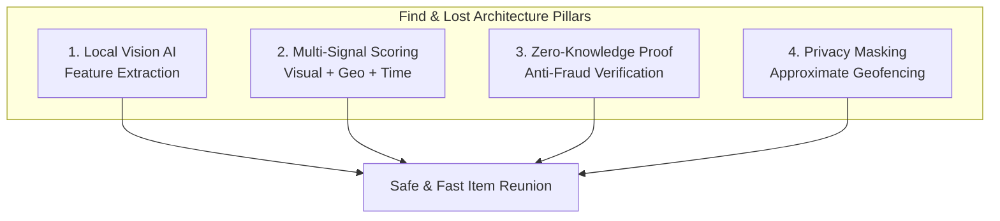

---

## 2. High-Level System Architecture

The following diagram illustrates the client-side architecture, local device APIs, background state, networking interceptors, and backend/AI infrastructure.

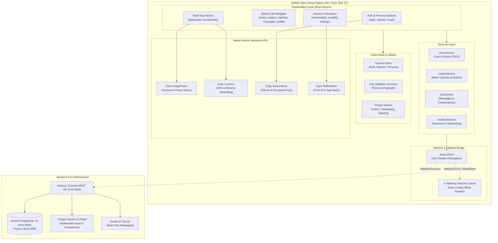

---

## 3. User Persona Journeys (Alex vs. Sarah)

The application provides a zero-friction dual-persona test bed allowing seamless switching between **User A (Alex - Item Owner)** and **User B (Sarah - Item Finder)**.

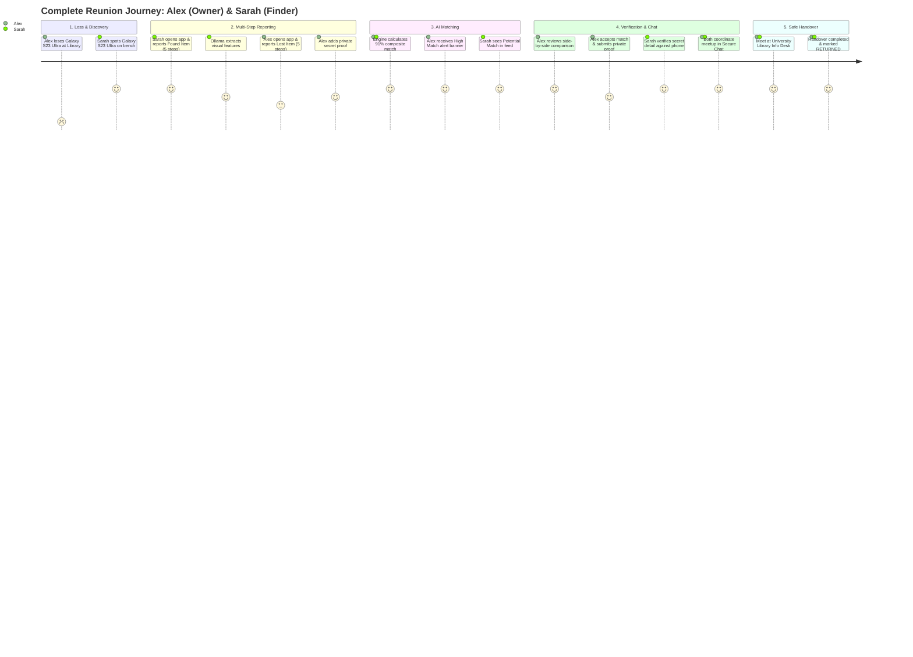

---

## 4. 5-Step Item Reporting Wizard Flow

Both `/lost/create` and `/found/create` guide users through a progressive 5-step wizard to maximize report accuracy without cognitive fatigue.

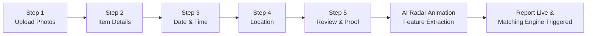

### Step-by-Step Detail Matrix

| Step | Action & UI Components | Inputs Captured | System Validations & Protections |
| :--- | :--- | :--- | :--- |
| **1. Upload Photos** | `ImagePickerGrid`<br/>Camera & Gallery actions | Up to 5 high-res photos, primary cover image | Minimum 1 image required. Images compressed and converted to URIs. |
| **2. Item Details** | `CategoryPills`<br/>Input text fields | Title, Category (14 choices), Brand, Model, Color, Distinctive Features | Title min 3 chars, Description min 10 chars, Category & Color mandatory. |
| **3. Date & Time** | Quick Preset Chips & Custom Picker | "Just now", "Today morning", "Yesterday", or custom timestamp | ISO-8601 formatting. Prevents future dates. |
| **4. Location** | GPS Auto-Detect Button & Area Input | Latitude, Longitude, City, State, Approximate Area Landmark | Reverse-geocoded to landmark (e.g., *"University Library Campus Center"*). Exact GPS coordinates are masked from public browse. |
| **5. Review & Proof** | Summary Card & Secret Proof Input | Hidden verification detail (Lost only), Terms agreement | **Zero-Knowledge field**: Stored securely; never displayed on public feeds or shared with unverified users. |
| **AI Radar Modal** | Simulated Ollama Vision Modal | Image payload dispatched for visual embedding | Extract color histogram, brand tags, OCR text, and feature tokens. |

---

## 5. AI Vision & Multi-Signal Matching Engine

The core matching algorithm evaluates **7 distinct similarity vectors** between every active Lost Item and Found Item.

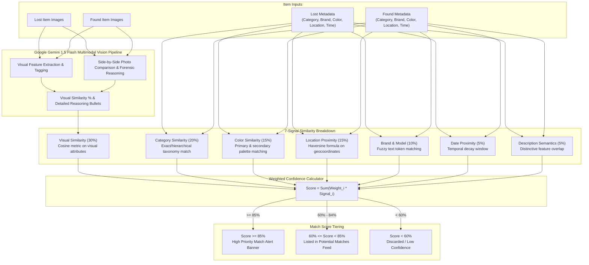

### Mathematical Formula

$$\text{MatchScore} = \sum_{i=1}^{7} w_i \cdot S_i$$

Where:
* $w_{vis} = 0.30$ (Visual Similarity)
* $w_{cat} = 0.20$ (Category Exact/Parent Match)
* $w_{col} = 0.15$ (Color Palette Overlap)
* $w_{loc} = 0.15$ (Spatial Decay: $e^{-\frac{\Delta km}{5}}$)
* $w_{brand} = 0.10$ (Brand/Model Fuzzy Match)
* $w_{date} = 0.05$ (Temporal Decay: $e^{-\frac{\Delta days}{7}}$)
* $w_{desc} = 0.05$ (Distinctive Feature Keyword Match)

---

## 6. State Machine & Entity Lifecycles

The application manages two interdependent state machines: the **Item Lifecycle** and the **Match Lifecycle**.

### Item Status Lifecycle

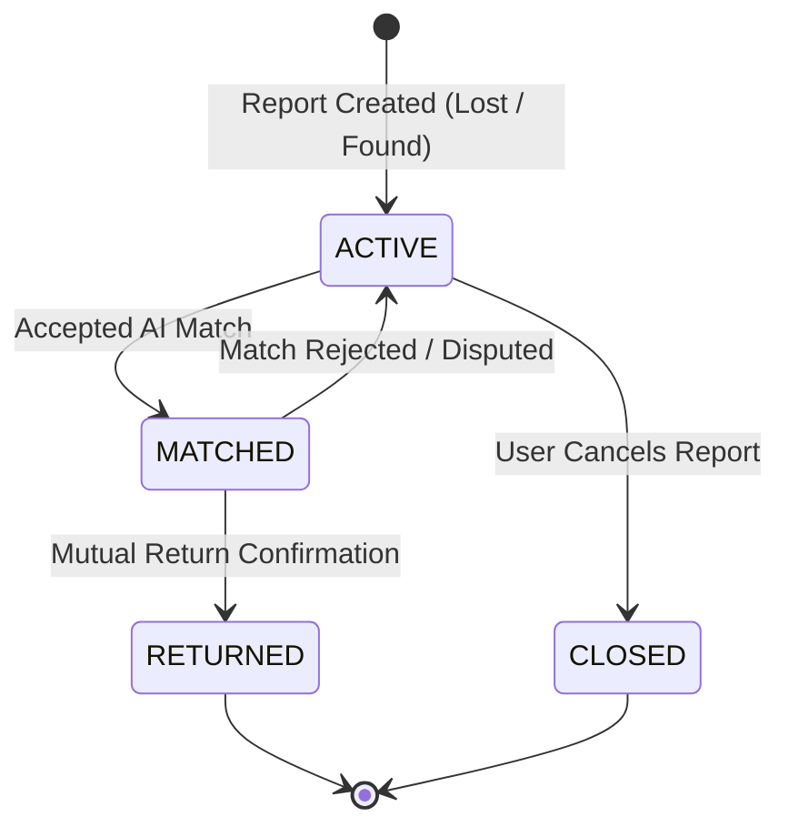

### Match Status Lifecycle

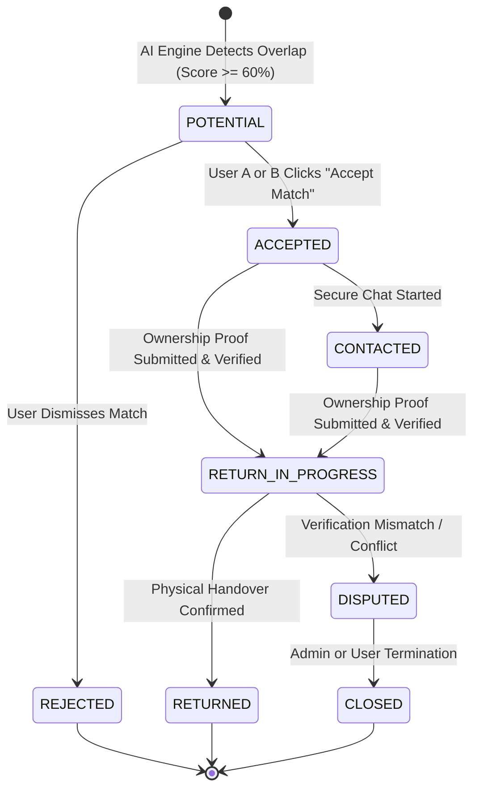

---

## 7. Zero-Knowledge Ownership Verification Protocol

To prevent opportunistic scammers from falsely claiming items found by others, the platform implements a **Private Verification Gate**.

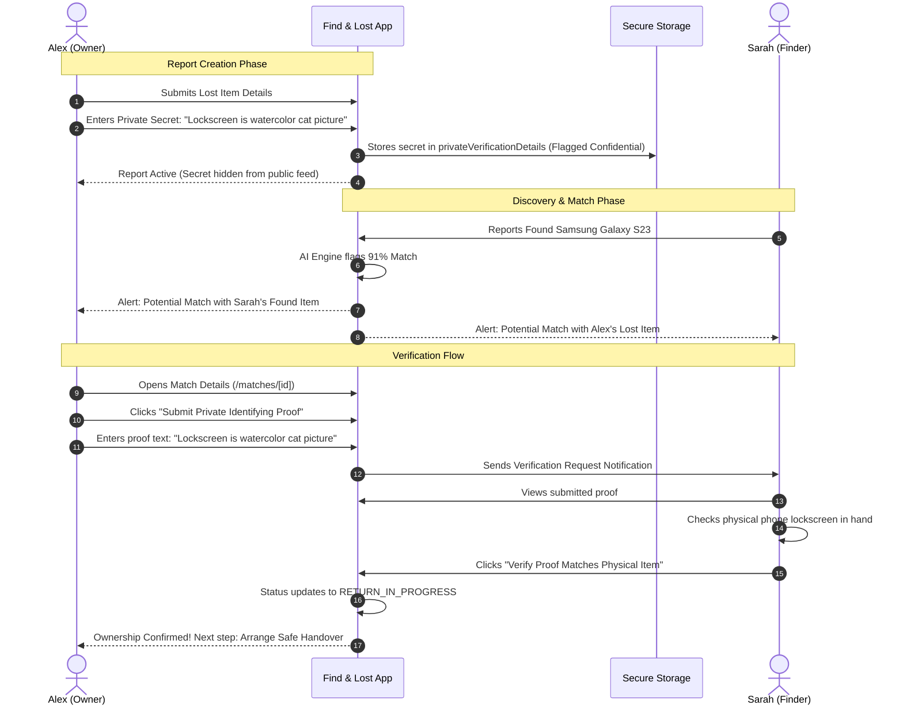

---

## 8. Secure In-App Chat & Safe Return Protocol

The chat system is uniquely tied to specific matches to maintain contextual safety and prevent harassment.

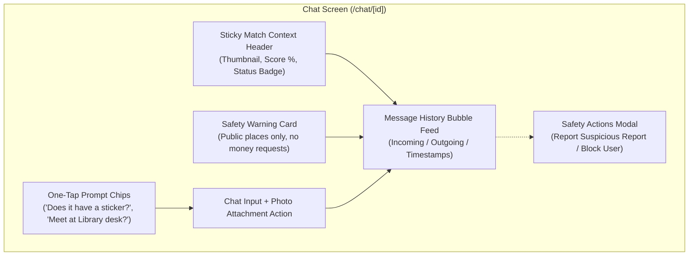

### Safe Return Handover Checklist

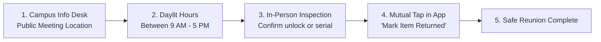

---

## 9. Screen Navigation & Routing Hierarchy

The app uses **Expo Router v4** file-based routing. The screen tree and navigation transitions are structured as follows:

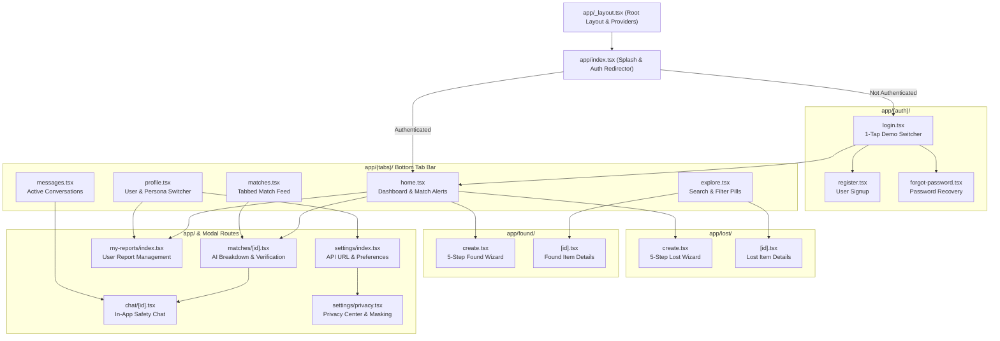

---

## 10. End-to-End Sequence Diagram

This sequence diagram depicts the complete chronological lifecycle of an item reunion from first loss to final handover.

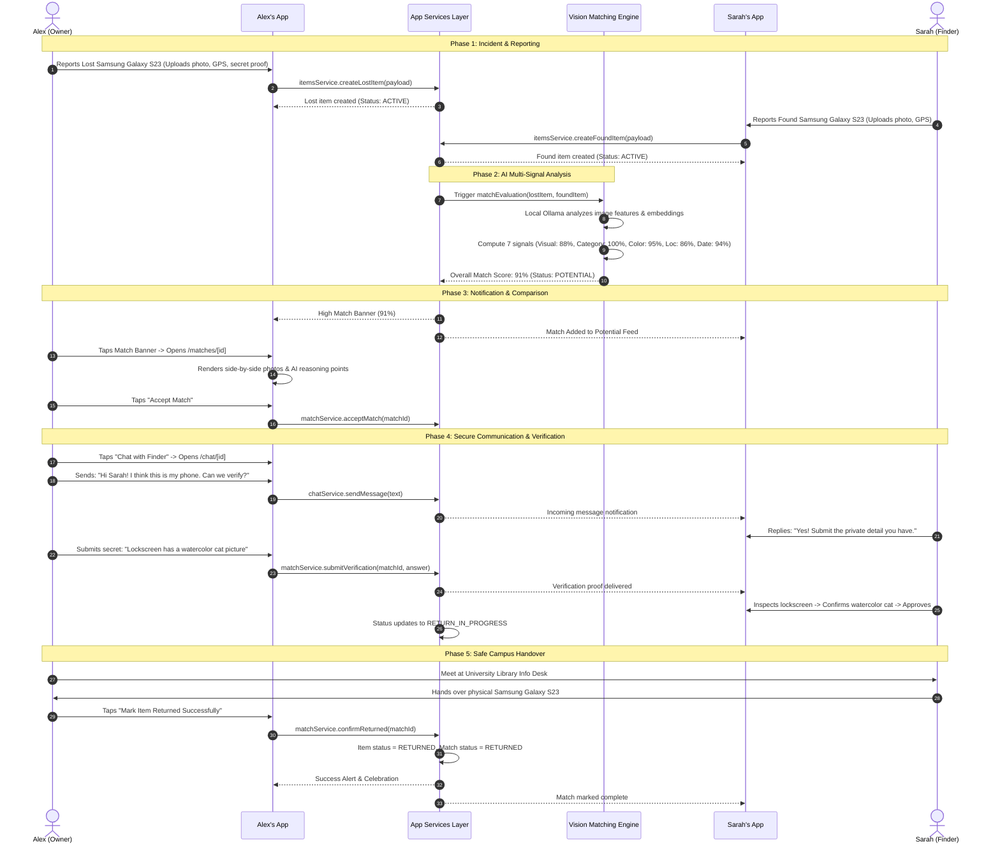

---

## 11. Data Models & API Contracts

### Core Domain Entities

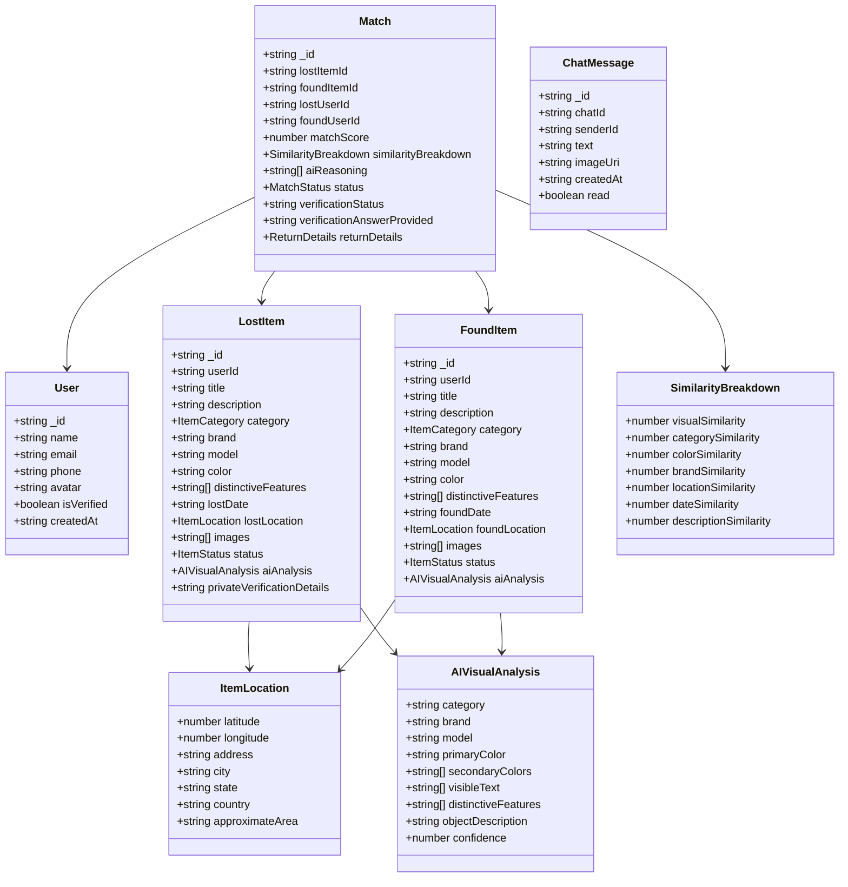

### Key API Endpoints & Contract Matrix

| Method | Endpoint | Description | Request Body / Query | Response Payload |
| :--- | :--- | :--- | :--- | :--- |
| `POST` | `/api/auth/login` | Authenticates user & returns JWT | `{ email, password }` | `{ user, token }` |
| `GET` | `/api/lost` | Query filtered lost items | `?category=&search=` | `LostItem[]` |
| `POST` | `/api/lost` | Creates new lost item report | `CreateLostItemPayload` | `LostItem` |
| `GET` | `/api/found` | Query filtered found items | `?category=&search=` | `FoundItem[]` |
| `POST` | `/api/found` | Creates new found item report | `CreateFoundItemPayload` | `FoundItem` |
| `GET` | `/api/matches` | Retrieve user AI matches | `?status=POTENTIAL` | `Match[]` |
| `POST` | `/api/matches/:id/accept` | Accept a potential match | None | `Match (ACCEPTED)` |
| `POST` | `/api/matches/:id/verify` | Submit private proof | `{ answer: string }` | `Match (RETURN_IN_PROGRESS)` |
| `POST` | `/api/matches/:id/returned` | Confirm handover | `{ handoverCompleted: true }` | `Match (RETURNED)` |
| `GET` | `/api/chats` | Retrieve conversation list | None | `ChatConversation[]` |
| `GET` | `/api/chats/:id/messages` | Load message thread | None | `ChatMessage[]` |
| `POST` | `/api/chats/:id/messages` | Send message in match thread | `{ text, imageUri? }` | `ChatMessage` |

---

## 12. Running & Testing the Workflow

1. **Launch App**:
   ```bash
   cd mobile
   npx expo start
   ```
2. **One-Tap Persona Flow**:
   - Tap **"Quick Login: User A (Alex - Owner)"** on login screen.
   - Tap the **"Potential Match Found! 91% Match"** alert banner on Home.
   - Review side-by-side comparison, 7-signal breakdown, and AI reasoning.
   - Tap **"Chat with Finder"** and coordinate.
   - Tap **"Submit Private Identifying Proof"** to simulate zero-knowledge verification.
   - Tap **"Mark Item Returned Successfully"**.
   - Switch persona to **Sarah (Finder)** from Profile to view the other perspective!
